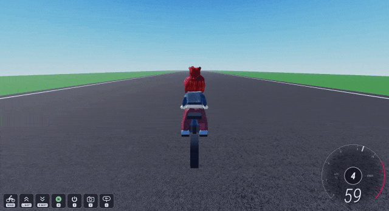
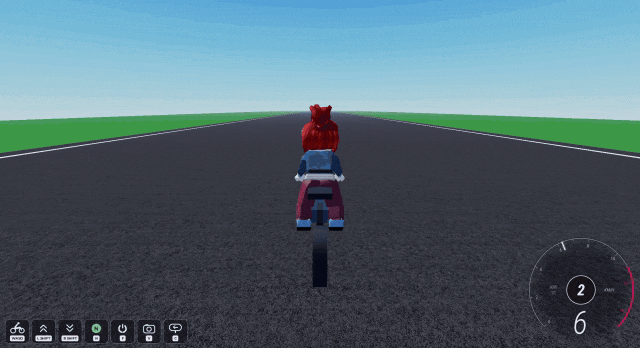
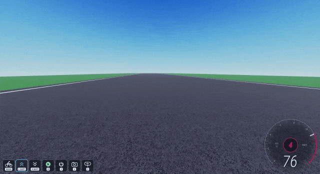
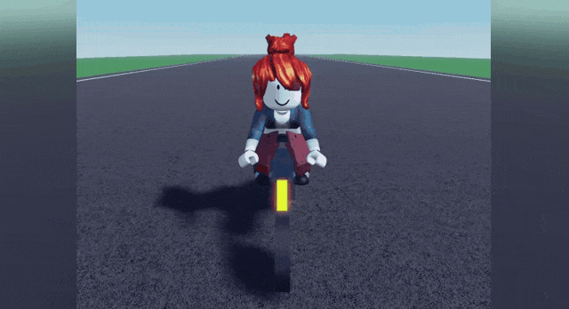
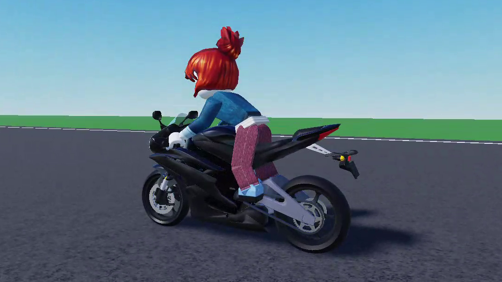
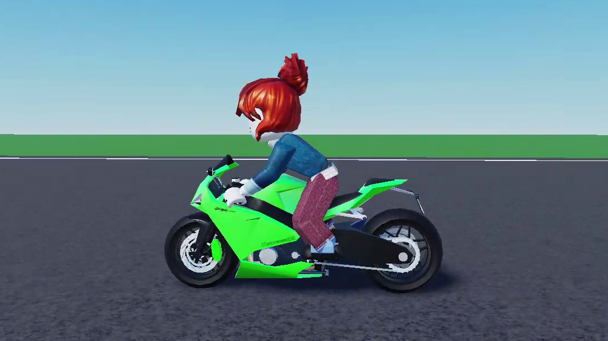

<div align="center">

# MotoRig

### A physics-based raycast motorcycle chassis for Roblox

**Real tire, suspension and lean physics in one drop-in model.**

[](https://github.com/Hohojae7/MotoRig/releases/latest)
[](https://github.com/Hohojae7/MotoRig/actions/workflows/ci.yml)
[](LICENSE)

**[Download](https://github.com/Hohojae7/MotoRig/releases/latest) · [How it works](#-how-it-works) · [Report a bug](https://github.com/Hohojae7/MotoRig/issues)**

[Features](#-features) · [Installation](#-installation) · [Controls](#-controls) · [Configuration](#-configuration)

</div>

---

MotoRig is a motorcycle you can drop into any Roblox map and ride. Its motion comes from a physics model of the tires, suspension, engine and the rider's balance, solved every frame. Everything else it needs, from controls and cameras to the dashboard and engine sound, lives inside the same model.

## ✨ Features

- **Pacejka tires:** Magic Formula grip curves with combined slip, camber thrust and load sensitivity, so the bike slides when it runs out of grip
- **Raycast suspension:** spring-damper fork and swingarm set by ride frequency, with round tire profiles that roll over curbs and bumps
- **Real lean and countersteering:** the lean follows the bicycle roll equation, and the rider countersteers into every turn
- **Engine and 6-speed gearbox:** torque curve, centrifugal clutch, rev limiter, reverse, ABS and traction control
- **Engine sound:** recorded engine loops that follow rpm and throttle, a rev limiter you can hear, and exhaust pops when you lift off at high revs
- **Keyboard and touch:** with chase and helmet cameras and a dashboard
- **Drop-in:** one self-contained model; run several bikes, use StreamingEnabled, or fit your own body shell

<!-- GIF grid: two per row -->
<table>
  <tr>
    <td align="center" width="50%">
      <br>
      <sub><b>Leaning and countersteering</b></sub>
    </td>
    <td align="center" width="50%">
      <br>
      <sub><b>Manual 6-speed gearbox</b></sub>
    </td>
  </tr>
  <tr>
    <td align="center" width="50%">
      <br>
      <sub><b>Chase and helmet views</b></sub>
    </td>
    <td align="center" width="50%">
      <br>
      <sub><b>Suspension over bumps</b></sub>
    </td>
  </tr>
</table>

## 📦 Installation

<!-- TODO: add the Creator Store steps once issue #4 is done -->
1. Download `MotoRig.rbxm` from the [latest release](https://github.com/Hohojae7/MotoRig/releases/latest).
2. Drag it into Studio and place it in `Workspace` with the wheels on the ground. Copies work too.
3. Press **Play**, walk up to the bike and hold **E** to get on.
4. The ride starts in neutral. Press **RightShift** for 1st gear, then **W** to ride off.

> [!IMPORTANT]
> Do not scale the model. The physics uses its real dimensions.

## 🎮 Controls

| Action | Keyboard | Touch |
|---|---|---|
| Get on | Hold `E` | Hold the prompt |
| Throttle | `W` | THROTTLE |
| Brake (front and rear) | `S` | BRAKE |
| Rear brake | `B` | |
| Lean | `A` / `D` | Drag on the left side |
| Gear up | `LeftShift` | SHIFT UP |
| Gear down | `RightShift` | SHIFT DOWN |
| Neutral | `N` | NEUTRAL |
| Engine on / off | `F` | ENGINE |
| Get off | `Space` | GET OFF |

Gears go 1-N-2-3-4-5-6. To reverse, stop in neutral and hold the brake for a second until `R` shows. In reverse, the throttle stops the bike and then puts it in 1st.

### Camera

| Action | Keyboard and mouse | Touch |
|---|---|---|
| Look around | Drag with the right mouse button | Drag outside the lean area |
| Zoom | Mouse wheel or `I` / `O` | |
| Chase / helmet view | `V` | VIEW |
| Look back (hold) | `C` | BACK |

Zooming all the way in also gives the helmet view.

## 🔧 Configuration

Every setting lives in the `BikeConfig` ModuleScript inside the bike. Open it in Studio, change a value and press Play. Each bike has its own `BikeConfig`, so bikes in the same map can be set up differently.

These are the settings you are most likely to change:

| Setting | Default | What it does |
|---|---|---|
| `Sound.Enabled` | `true` | `false` turns the engine sound off |
| `Sound.Profile` | see `BikeConfig` | Which recorded engine plays, from the list in `Sound.Profiles` |
| `Camera.Enabled` | `true` | `false` leaves the camera to Roblox while riding |
| `Dashboard.Enabled` | `true` | `false` hides the meter and the control tiles |
| `Dashboard.SpeedUnit` | `"km/h"` | `"km/h"`, `"mph"` or `"studs/s"` |
| `Dashboard.RedZoneRPM` | `11000` | Where the meter's red zone starts and the gear turns red |
| `Dashboard.Hints` | `true` | `false` hides the control tiles at the bottom left |
| `Dashboard.TouchControls` | `true` | `false` hides the touch buttons, for maps with their own |
| `Mount.ActionText` | `"Ride"` | The action text on the ride prompt |
| `Mount.ObjectText` | `"MotoRig"` | The name on the ride prompt |
| `Engine.AutoStartOnMount` | `true` | Starts the engine when the rider gets on |
| `Engine.StopOnDismount` | `true` | Stops the engine when the rider gets off |
| `Diagnostics.Enabled` | `false` | `true` prints development info to the Output |

The rest of `BikeConfig` is the physics, covered in [Tuning the physics](#tuning-the-physics).

## 🎨 Custom exterior

<table>
  <tr>
    <td align="center" width="50%">
      
    </td>
    <td align="center" width="50%">
      
    </td>
  </tr>
</table>
<p align="center"><sub><b>Example shells on the same chassis (not included)</b></sub></p>

| Dimension | Studs | Meters |
|---|---|---|
| Front wheel diameter | 2.08 | 0.58 |
| Front wheel width | 0.38 | 0.11 |
| Rear wheel diameter | 2.25 | 0.63 |
| Rear wheel width | 0.52 | 0.15 |
| Wheelbase (axle to axle) | 5.30 | 1.48 |
| Seat height (top of the seat) | 3.44 | 0.96 |

<sub>1 stud = 0.28 m, the scale the bike is built to.</sub>

To fit your own shell:
- Put it in a Model named `Exterior` inside the bike, split into `Body`, `Steering`, `Fork`, `FrontWheel`, `RearWheel` and `Swingarm` models.
- Add an `Axle` attachment at each wheel center and a `Pivot` attachment on the swingarm pivot. The shell is moved, never resized, so keep the axles 5.30 studs apart.
- The shell is only visual: it has no mass and no collision, so the bike rides the same.

## 🔬 How it works

The chassis is one rigid body and the wheels are raycast. Every physics frame, before Roblox runs its own solver, MotoRig finds the ground under each tire, solves the suspension, tires, engine and brakes together, and updates the lean. Each part below gives the equation and the Luau that implements it.

### Tire contact

Each tire is a torus: spherecasts trace its round profile, so the wheel rolls over curbs instead of catching on a single ray.

```lua
for _, offset in wheel.samples do
    local hit = self.world:Spherecast(
        origin + arcRotation:VectorToWorldSpace(offset),
        wheel.profileRadius,
        direction,
        self.raycastParams
    )
```

<sub><code>BikeDynamics:_probe</code> in <a href="src/BikeDynamics.luau">src/BikeDynamics.luau</a></sub>

&nbsp;

### Suspension

The spring is chosen so each corner rides at a set frequency, with the tire as a second spring in series.

```math
k_\text{ride} = m\,(2\pi f)^2, \qquad k_\text{spring} = \frac{k_\text{ride}\,k_\text{tire}}{k_\text{tire} - k_\text{ride}}
```

where $m$ is the mass on that wheel, $f$ the ride frequency and $k_\text{tire}$ the tire's stiffness.

```lua
local omega = 2 * math.pi * wheel.suspension.Frequency
local rideRate = math.min(cornerMass * omega * omega, tireRate * 0.9)
local verticalSpringRate = rideRate * tireRate / (tireRate - rideRate)
```

<sub><code>BikeDynamics:_refreshMassProperties</code> in <a href="src/BikeDynamics.luau">src/BikeDynamics.luau</a></sub>

&nbsp;

### Tires

Grip follows Pacejka's Magic Formula, for both the lateral and the longitudinal force.

```math
F(x) = D \sin\!\Big(C \arctan\big(Bx - E\,(Bx - \arctan Bx)\big)\Big)
```

where $x$ is the slip and $B$, $C$, $D$, $E$ are the stiffness, shape, peak and curvature factors. Past the peak the force falls off and the tire slides.

```lua
local function tireCurveValue(curve, slip)
    local x = curve.stiffness * slip

    return math.sin(curve.shape * math.atan(x - curve.curvature * (x - math.atan(x))))
end
```

<sub><code>tireCurveValue</code> in <a href="src/BikeDynamics.luau">src/BikeDynamics.luau</a> (peak normalized to 1)</sub>

&nbsp;

### Lean and countersteering

The lean follows the bicycle roll equation about the tire contact line.

```math
I\,\ddot{\varphi} = m g h \sin\varphi - m h\,a_\text{lat}\cos\varphi + M_\text{gyro}
```

```math
a_\text{lat} = \frac{(v^2 + b\,\dot{v})\tan\delta + b\,v\,\dot{\delta}\,\sec^2\delta}{L}
```

where $\varphi$ is the lean, $h$ the height of the center of mass, $\delta$ the steering angle, $L$ the wheelbase and $b$ the distance from the rear contact to the center of mass. The $\dot{\delta}$ term is the countersteer: steering away from a turn first tips the bike into it.

```lua
lateralAcceleration = (
    (speedSquared + toCenter * acceleration) * tanSteer
    + toCenter * speed * steerRate * (1 + tanSteer * tanSteer)
) / wheelbase

-- I roll'' = m g h sin(roll) - m h a_lat cos(roll) + gyroscopic
moment = gravityMoment * math.sin(roll)
    - mass * height * lateralAcceleration * math.cos(roll)
    + gyroscopicMoment
```

<sub><code>BikeDynamics:_updateRider</code> in <a href="src/BikeDynamics.luau">src/BikeDynamics.luau</a></sub>

&nbsp;

### Air drag

```math
\vec{F}_d = -\frac{1}{2}\,\rho\,C_d\,A\,|\vec{v}_\text{air}|\,\vec{v}_\text{air}, \qquad \vec{v}_\text{air} = \vec{v} - \vec{v}_\text{wind}
```

where $\rho$ is the map's air density, $C_d$ the drag coefficient and $A$ the frontal area of the bike and rider. The wind is the map's `GlobalWind`.

```lua
local airVelocity = velocity - self.wind
local drag = airVelocity
    * (-0.5 * self.airDensity * config.Aero.DragCoefficient * self.frontalArea * airVelocity.Magnitude)
```

<sub><code>BikeDynamics:step</code> in <a href="src/BikeDynamics.luau">src/BikeDynamics.luau</a></sub>

&nbsp;

### Engine and clutch

The centrifugal clutch's shoes press outward with a force that grows with the square of engine speed, so the torque it can carry rises from engagement to lock-up.

```math
T_\text{clutch} = T_\text{max} \cdot \mathrm{clamp}\left(\frac{n^2 - n_\text{engage}^2}{n_\text{lock}^2 - n_\text{engage}^2},\ 0,\ 1\right)
```

where $n$ is the engine speed in rpm.

```lua
local fraction = clamp((rpm * rpm - engage * engage) / (lock * lock - engage * engage), 0, 1)

return fraction * drivetrain.ClutchCapacityRatio * Powertrain.peakTorque(drivetrain)
```

<sub><code>Powertrain.clutchCapacity</code> in <a href="src/BikeDynamics.luau">src/BikeDynamics.luau</a></sub>

&nbsp;

### Engine sound

An engine's pitch follows its firing frequency, so each recorded loop is played faster or slower to match the engine speed.

```math
f = \frac{\text{rpm}}{60} \cdot \frac{n_\text{cyl}}{2}, \qquad \text{speed} = \frac{\text{rpm}_\text{sound}}{\text{rpm}_\text{recorded}}
```

```lua
layer.speed = math.clamp(soundRPM / layer.loop.RecordedRPM, MIN_SPEED, MAX_SPEED)
```

<sub><code>BikeSound:update</code> in <a href="src/BikeSound.luau">src/BikeSound.luau</a></sub>

&nbsp;

### Built on Roblox

| Roblox API | What MotoRig uses it for |
|---|---|
| `WorldRoot:Spherecast` | Finding the ground under each tire's round profile |
| `VectorForce`, `Torque` | Putting the tire, suspension and drag forces on the chassis |
| `AlignOrientation` | Holding the chassis at the solved lean |
| `RunService.PreSimulation` | Stepping the bike every physics frame, before Roblox's solver |
| `BasePart:SetNetworkOwner` | Letting the rider's client run the bike, so it answers input without network delay |
| `UnreliableRemoteEvent` | Sending the bike's visual state and engine speed to other players |
| `ProximityPrompt` | The ride prompt |
| `Script.RunContext = Client` | Client scripts that run from inside the model, so nothing goes in StarterPlayer |
| `TremoloSoundEffect`, `EqualizerSoundEffect` | The rev limiter's stutter and the tone of the exhaust pops |
| `Workspace.Gravity`, `AirDensity`, `GlobalWind` | The map's own gravity, air and wind in the physics |

&nbsp;

### Tuning the physics

The physics settings in `BikeConfig`, by group:

| Group | What it changes | Key settings |
|---|---|---|
| `Mass` | Chassis weight, center of mass and wheel weight | `BallastMass`, `WheelDensity` |
| `Suspension` | How soft the bike rides and how fast it settles, front and rear | `Frequency`, `SagRatio`, `BumpDampingRatio`, `ReboundDampingRatio` |
| `Tire` | Grip and how the tire lets go, combined with the surface's own friction | `Friction`, `CorneringStiffness`, `LateralShape` |
| `Aero` | Air drag, and with it the top speed | `DragCoefficient` |
| `Steering` | Steering lock and how quickly the input follows the keys | `MaxGroundSteerAngle`, `InputResponse` |
| `Lean` | How far and how quickly the bike leans | `MaxLeanAngle`, `MaxYawRate`, `RiderRollFrequency` |
| `Drivetrain` | Engine torque, gearing, clutch and traction control | `TorqueCurve`, `GearRatios`, `FinalDriveRatio`, `RevLimitRPM` |
| `Brakes` | Braking strength and ABS | `MaxDeceleration`, `ABS` |

> [!TIP]
> The physics values work together. Change one at a time and ride after each change.

## 📄 License

MotoRig is licensed under the [Mozilla Public License 2.0](LICENSE).
